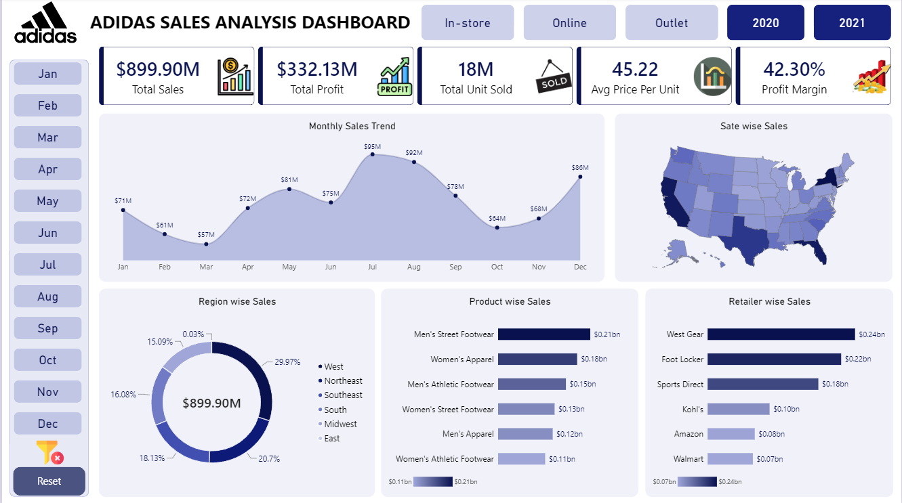

# Adidas US Sales Performance Analysis Dashboard
An end-to-end business intelligence project analyzing retail performance, regional distributions, and product segment revenue across the United States using Power BI.
---
## Dashboard Preview

---
## Executive Summary
This interactive dashboard tracks commercial metrics across in-store, online, and outlet sales channels. The analysis identifies key growth drivers, seasonal fluctuations, and retailer contributions to optimize retail inventory and marketing strategies.
### Key Performance Indicators
* Total Sales: $899.90M
* Total Operating Profit: $332.13M
* Total Units Sold: 18M
* Average Price Per Unit: $45.22
* Operating Profit Margin: 42.30%
---
## Core Insights
* Top Product Categories: Men's Street Footwear leads overall revenue at $0.21B, followed by Women's Apparel at $0.18B.
* Key Retail Partners: West Gear and Foot Locker generated the highest revenue shares at $0.24B and $0.22B.
* Regional Performance: The West region commands the highest sales volume at ~30%, with strong contributions from the Northeast and Southeast.
* Seasonal Spikes: Demand peaks during July-August and the December holiday shopping period.
---
## Features & DAX Implementation
* Dynamic Slicers: Filter by sales method [In-store, Online, Outlet], year [2020, 2021], and individual months.
* Interactive Visuals: Custom KPI cards, donut distribution charts, regional geospatial maps, and month-over-month sales trend lines.
* Data Reset: One-click bookmark navigation to clear active filters.
---
## Tools & Technologies
* Power BI Desktop
* Power Query for data cleaning and transformation
* DAX for calculated measures and margin ratios
* Microsoft Excel / CSV
---
##Author
Rumana Yasmin
---
